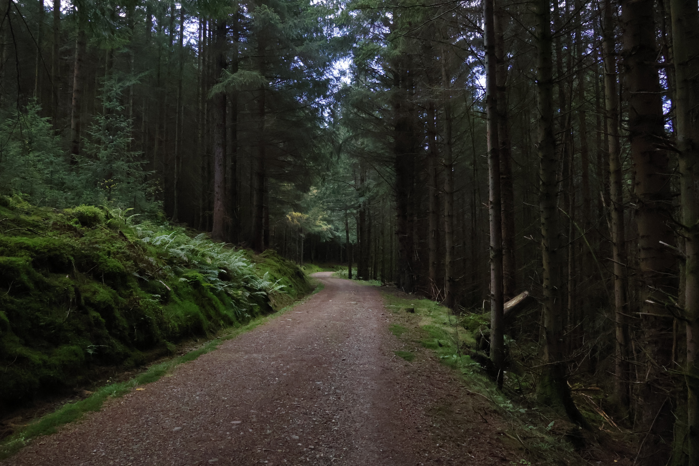
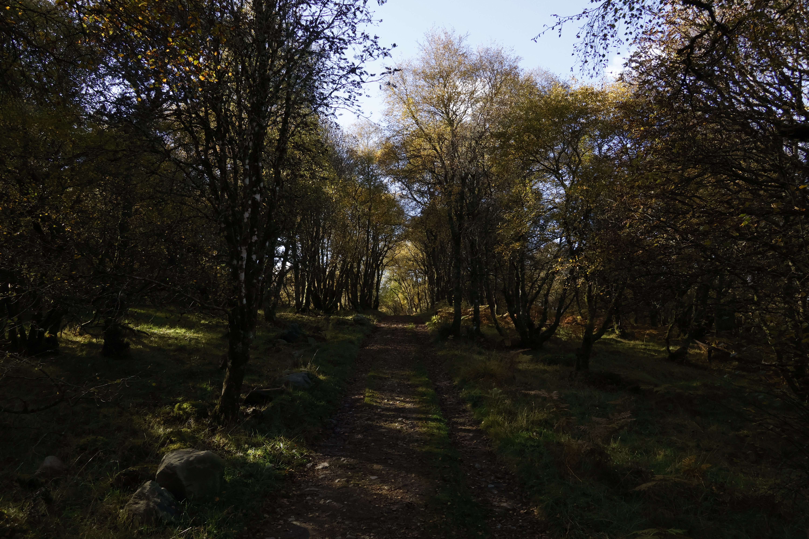
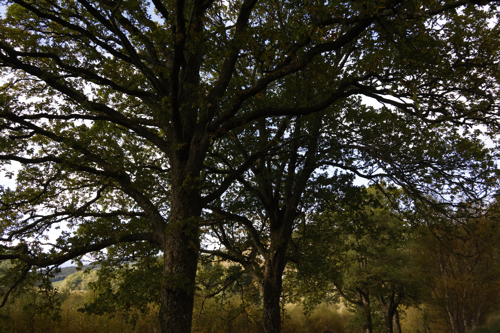
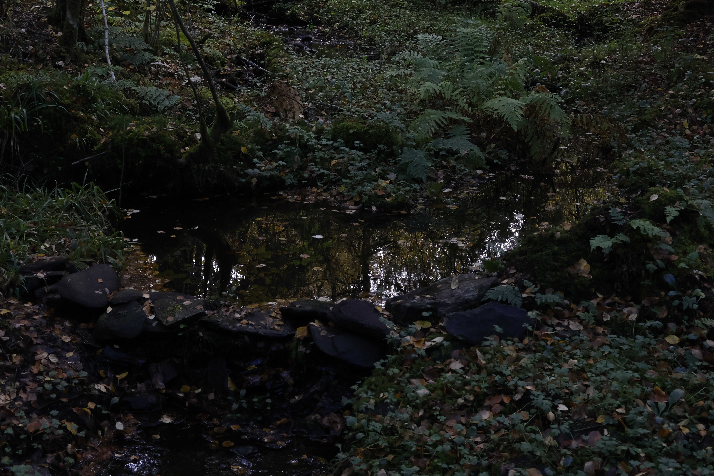
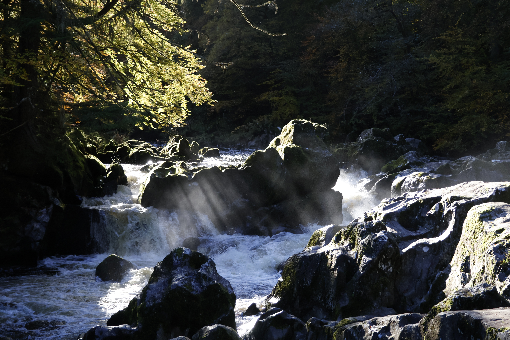
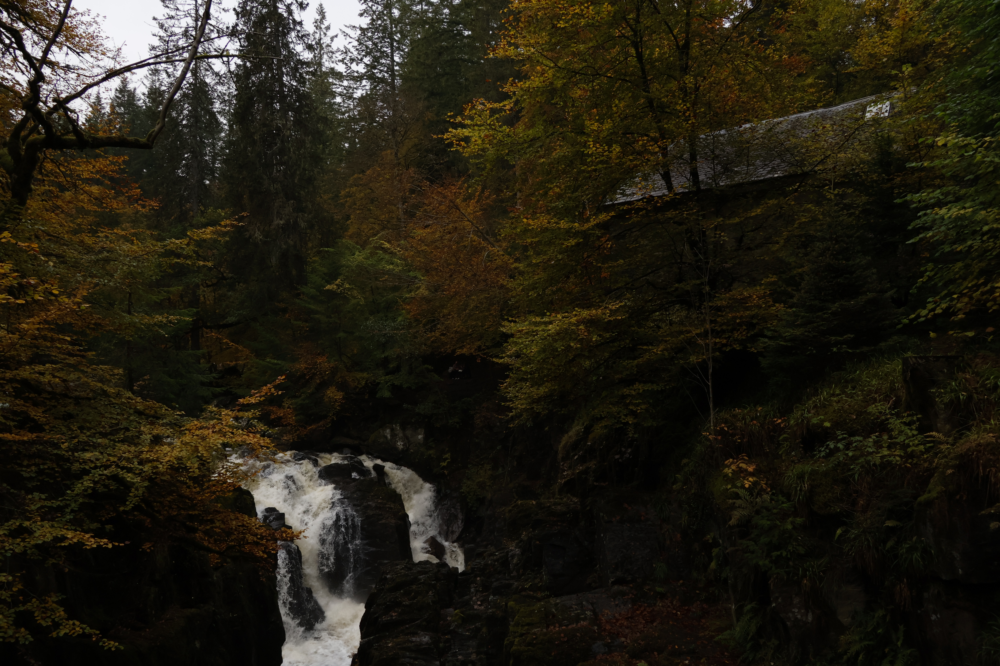
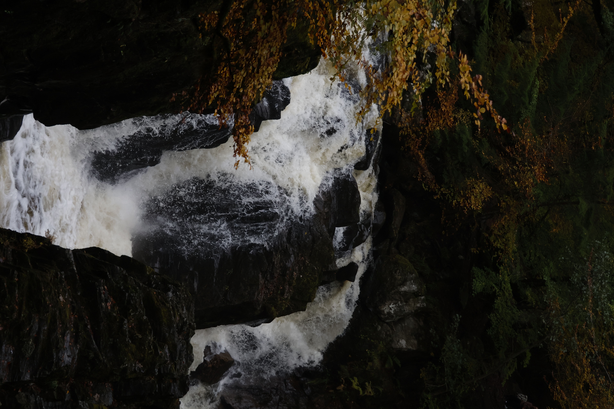
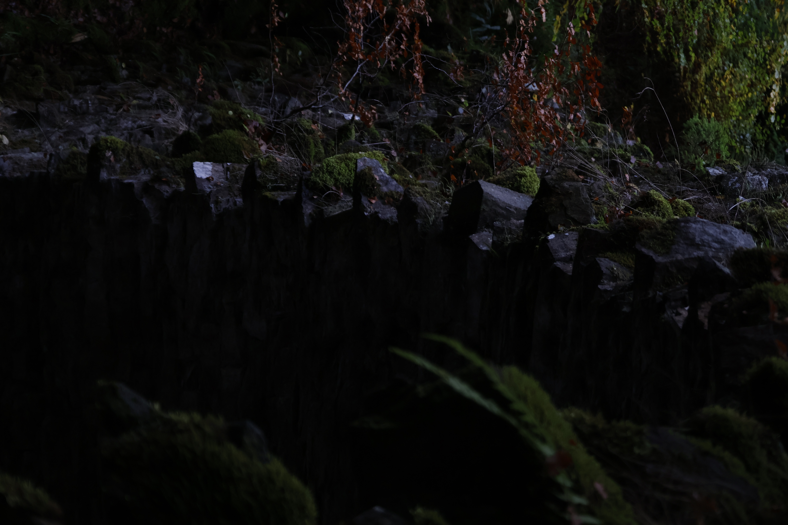

## Into the Woods

  
  

The Hermitage is a patch of woodland on the River Braan, just outside Dunkeld in Perthshire. The walk starts on a wide gravel track under tall conifers, the bank on one side thickly covered in moss and bracken, the light coming down in thin shafts from far above. Further on the forest changes character: the conifers give way to birch and the track narrows, the trees turn yellow at the edges, and patches of sun reach the ground.

## Oaks & Still Water

  
  

Between the plantation and the river stand some properly old broadleaf trees. These two oaks spread their branches out over the path in a canopy so wide you have to tilt your head back to take it in. Off the trail, a small pool sits among ferns and moss, ringed by a few flat stones. Fallen leaves float on the black water, which mirrors the trees overhead almost perfectly.

## The River Braan

  

Then you hear the river before you see it. The Braan runs through a narrow, rocky gorge here, and where it squeezes between the boulders it turns to white water. Spray hangs in the air above the rapids and catches the low sun in visible beams, which light up the mossy rocks against the dark trees behind.

## Black Linn Falls

  
  
  

The main attraction is the **Black Linn Falls**, where the river drops through a cleft in dark rock into a churning pool. From the viewing area the falls sit at the bottom of the frame, with the slate roof of Ossian's Hall — an eighteenth-century folly built to frame this exact view — just visible through the trees above. Close up, the water is brown-white with peat and fast enough to throw spray up the rock faces. The stonework along the gorge, stacked and covered in moss, is the last detail before the path turns back into the trees.
